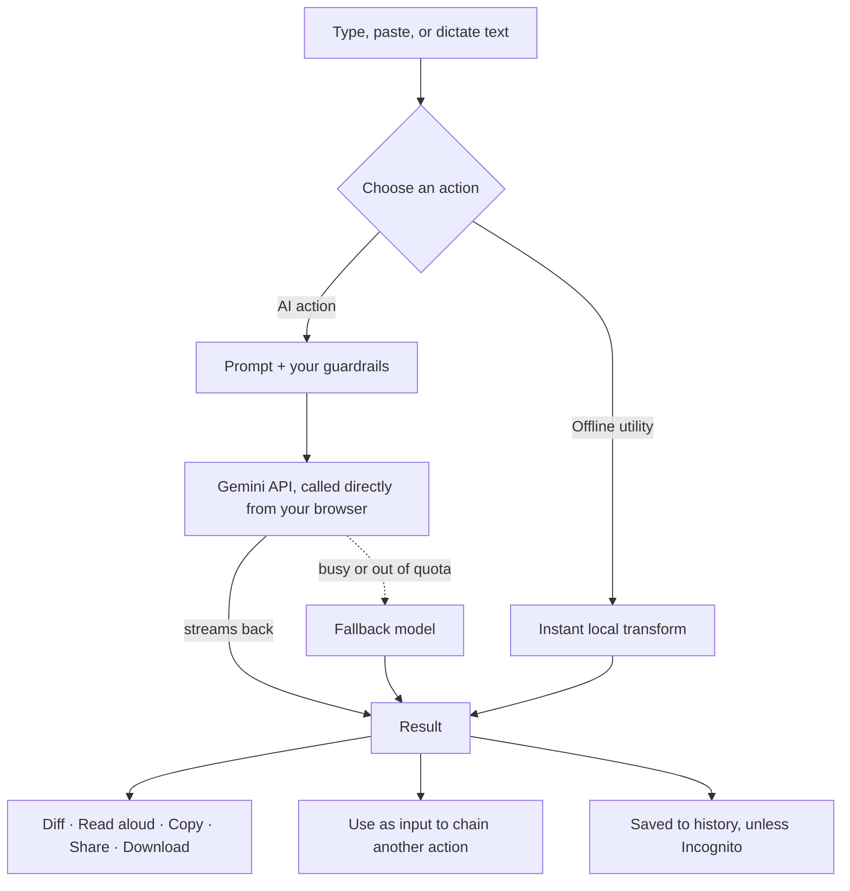

  

  # Verbatim Studio

  ### *The Premium AI-Powered Text Transformation Suite*

  
  
  

  

    <strong>Verbatim Studio</strong> is a fast, client-side AI writing studio for rewriting, grammar fixes, tone changes, translation, and voice dictation. It runs entirely in your browser, works great on phones and laptops, and is based on the <a href="https://chromewebstore.google.com/detail/codesavvy/jenendhnlcnokliclhccikgeohdgfhml"><strong>CodeSavvy Chrome Extension</strong></a>.
  

---

## 🚀 Live Access, Extension & Repository

* 🌐 **Live Studio:** [mahdialaaaldin.github.io/verbatim](https://mahdialaaaldin.github.io/verbatim/)
* 🧩 **Chrome Extension:** [CodeSavvy on Chrome Web Store](https://chromewebstore.google.com/detail/codesavvy/jenendhnlcnokliclhccikgeohdgfhml)
* 📦 **GitHub Repository:** [github.com/mahdialaaaldin/verbatim](https://github.com/mahdialaaaldin/verbatim)

---

## 🆕 What's New in v2

* ⚡ **Live streaming output** : watch the result appear as Gemini writes it, and stop it anytime with **Stop** or `Esc`.
* 🎙️ **Voice dictation** : speak instead of typing, including Arabic (Lebanon, Saudi Arabia, Egypt), English, French, Spanish, and German.
* ✂️ **Edit just a selection** : highlight part of your text and any action (AI or offline) changes only that part.
* 🔗 **Chain actions** : **Use as input** sends the result back to the editor so you can run another action on it. **Regenerate** reruns the last one.
* 🔎 **Command palette** : press `Ctrl/⌘ + K` to search every action and command.
* 🌍 **New presets** : Make Concise, Simplify, Email Draft, Translate → English, and Translate → Arabic.
* 🧹 **New offline tools** : clean spaces, fix broken line breaks (great for PDF text), sort lines, remove duplicate lines, and remove Arabic diacritics (تشكيل).
* 🤖 **Smarter model handling** : Flash Lite (latest) by default, a "Load my models" button, and automatic fallback when a model is busy or out of quota.
* 📱 **Rebuilt mobile experience** : a bottom action bar within thumb reach, a bottom-sheet Settings panel, notch-safe layout, and no zoom-on-tap on iPhone.
* ↩️ **Undo everywhere** : clearing text, pasting, deleting history, and removing presets can all be undone from the notification.
* 🛡️ **Many bug fixes** : including the Arabic keyboard fixer, Copy with Diff on, the mobile/desktop layout switch, and safer settings import.

---

## ✨ Features at a Glance

### 🧠 AI Actions (Google Gemini)
* ✨ **Correct & Polish** : fix grammar, typos, and flow while keeping your voice.
* 🖋️ **Advanced Edit** : a full vocabulary, syntax, and flow overhaul.
* 💼 **Professional** : formal wording for business emails and reports.
* 💬 **Conversational** : warm, natural wording for chats and notes.
* ✂️ **Make Concise** : cut filler while keeping every key point.
* 💡 **Simplify** : plain language with short sentences.
* 🗜️ **Summarize** : the core message in 1–2 sentences.
* 📊 **Bullet Points** : turn paragraphs into a scannable list.
* 📐 **Expand** : add detail and depth to brief notes.
* ✉️ **Email Draft** : turn rough notes into a ready-to-send email with a subject line.
* 🌐 **Translate → English / Translate → Arabic** : natural, fluent translation.
* 🎭 **Sarcastic** : dry humor and wit.
* 🤖 **Prompt Architect** : turn a basic idea into a structured prompt for AI models.

Every action replies in the same language as your text unless it's a translation. Your text is treated as content to edit, so Gemini won't try to *answer* questions inside it.

### 🎛️ Personalization & Guardrails
* ⭐ **Favorite action (★)** : pin any built-in **or custom** preset to the front, and run it with `Ctrl/⌘ + Enter`.
* 🧩 **Custom presets** : write your own prompts, then reorder, edit, or delete them.
* 👁️ **Show/hide built-in actions** : keep the action bar short (your favorite can't be hidden).
* 🔒 **Protected Terms Dictionary** : brand names and terms Gemini must never change or translate.
* ✍️ **Custom System Instructions** : global rules added to every request (e.g. "Always use British English").

### ⚡ Offline Utilities (0ms • No API Key Needed)
* 🔤 **Case converters** : Sentence case, lower case, UPPER CASE, Capitalized Case, Title Case, `slug-format`, `aLtErNaTiNg`, `iNVERSE`.
* 🧹 **Cleanup tools** : clean spaces, fix line breaks, sort lines, dedupe lines, remove تشكيل.
* ⌨️ **Arabic ⇄ English keyboard fixer** : recover text typed on the wrong layout (`ؤاشف` ⇄ `chat`, `login` ⇄ `مخلهى`). It handles أ / إ / آ / لا, Caps Lock, and Arabic-Indic digits.

### 🔍 Working With Results
* 🟢🔴 **Word-level diff** : see exactly what changed.
* 🔊 **Read aloud** : text-to-speech for long text, with an Arabic voice for Arabic.
* 📋 **Copy, share, or download** the result as `.txt`.
* 🟡 **"Input edited" alert** : shows when the result no longer matches your current text, with one-tap regenerate.

### 📜 History & Privacy
* 🗂️ **Revision history** : search, restore, copy, delete, and export as JSON.
* 🕶️ **Incognito mode** : pause history and draft saving with one tap.
* ⏳ **Auto-delete** : after 1 day, 3 days, 1 week, 1 month, or a custom duration.
* 💾 **Draft autosave** : your text survives a page reload (optional, paused in Incognito).
* 🗃️ **Backup & restore** : export or import settings and presets as JSON (your API key is never included).

### 🎨 Design & Experience
* 🌓 Light and dark themes that follow your system setting.
* 🔤 Mixed Arabic/English text: each paragraph gets the right direction automatically.
* 📱 Mobile bottom action bar, swipe-friendly preset bars, and installable as an app.
* ⌨️ Full keyboard shortcuts and a command palette on desktop.

---

## ⌨️ Keyboard Shortcuts

| Shortcut | Action |
| --- | --- |
| `Ctrl/⌘ + Enter` | Run your ★ favorite action |
| `Ctrl/⌘ + Shift + Enter` | Use the result as input |
| `Ctrl/⌘ + K` | Open the command palette |
| `Alt + 1–9` | Run an AI action by its position |
| `Esc` | Stop generating / close panels |

> 💡 **Tip:** Select part of your text first, and any action applies to that selection only.

---

## 🤖 Choosing a Model

* ⭐ **Flash Lite (latest)** is the default and the recommendation. It's fast, low cost, uses the fewest tokens, and automatically points to Google's newest Flash Lite model.
* **Flash** models are smarter but slower and use more tokens. **Pro** models are the slowest and most expensive.
* **Load my models** lists the models your API key can use. It automatically hides models that can't edit text (image, audio, embedding, and similar). After choosing a new model, press **Test connection**.
* **Auto-fallback:** if your model is busy or out of quota, Verbatim tries other Flash Lite models first, then regular Flash as a last resort.

---

## ⚙️ How It Works

---

## 🔐 API Key Setup & Privacy

Verbatim Studio runs entirely in your browser. There's no Verbatim server. Your API key is stored only in this browser's `localStorage`, and it's sent only to Google's official Gemini API.

### Setup
1. Get a free key from [Google AI Studio](https://aistudio.google.com/app/apikey).
2. Open **Settings** (the gear icon) in Verbatim Studio.
3. Paste your key. It saves automatically, and you can press **Test connection** to check it.

> 🛡️ **Tip:** Use a dedicated API key for Verbatim, and don't save your key on shared or public computers.

---

## 🛠️ Tech Stack

* **UI:** HTML5 + [Tailwind CSS](https://tailwindcss.com) (CDN)
* **Fonts & icons:** Inter, Outfit, Noto Sans Arabic (Google Fonts), Font Awesome 6
* **AI:** Google Gemini API through native `fetch`, with streaming (SSE)
* **Voice:** Web Speech API (speech recognition for dictation, speech synthesis for read-aloud)
* **Diff:** a custom word-level diff engine (`<ins>` / `<del>`)
* **Storage:** `localStorage` only, with no backend

> Voice dictation needs a browser that supports speech recognition, such as Chrome, Edge, or Safari.

---

## 📲 Installing as a Mobile App (PWA)

### iOS (Safari)
1. Open the [Live Demo](https://mahdialaaaldin.github.io/verbatim/) in Safari.
2. Tap the **Share** button.
3. Choose **Add to Home Screen**.
4. Launch it from your home screen for a full-screen, app-like experience.

### Android (Chrome)
1. Open the [Live Demo](https://mahdialaaaldin.github.io/verbatim/) in Chrome.
2. Tap the **three-dot menu** in the top right.
3. Choose **Install app** or **Add to Home screen**.

---

## 📌 Related Projects

* **[CodeSavvy (Browser Extension)](https://chromewebstore.google.com/detail/codesavvy/jenendhnlcnokliclhccikgeohdgfhml)** – the original AI writing assistant extension for your browser.

---

## 📄 License

This project is licensed under the MIT License. See the [LICENSE](LICENSE) file for details.
